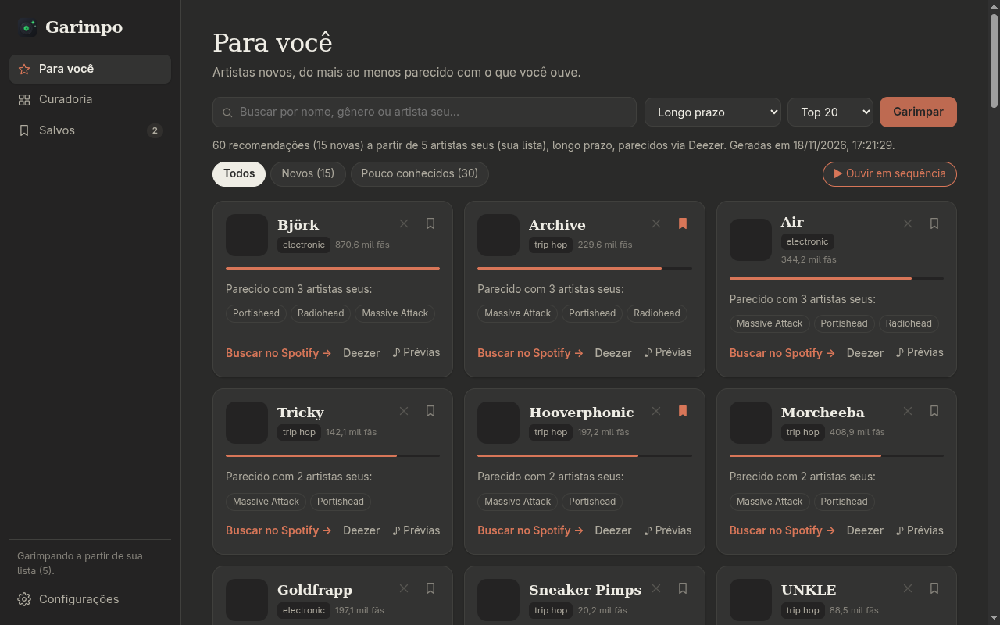
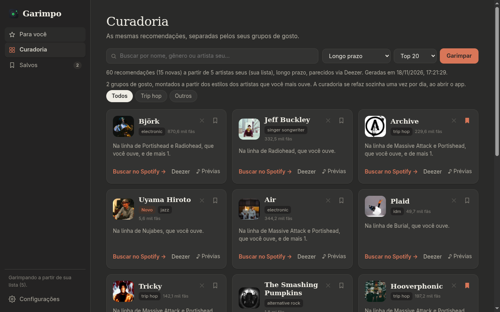
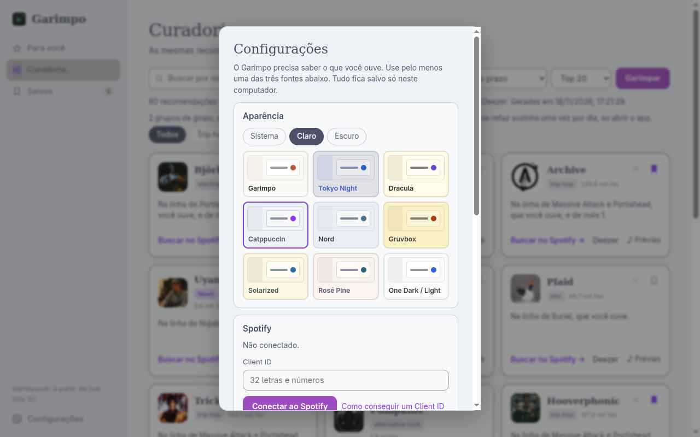

# Garimpo

[](https://github.com/Lobbyboya/garimpo/actions/workflows/testes.yml)
[](https://github.com/Lobbyboya/garimpo/releases/latest)

*[Leia em português](README.md)*

**Garimpo** (Portuguese for *digging for gold*) is a desktop app that finds new artists based on
what you already listen to. It reads your taste from Spotify, Last.fm or a short list you type,
scores similar artists, and keeps the recommendations fresh as your listening changes.



## Features

- **Works without an account**: type three artists you like and get recommendations right away.
  Spotify and Last.fm are optional, for recommendations based on your real listening history.
- **For you**: a ranked list with an affinity score, the artists of yours that led to each
  suggestion, **New** badges for artists never recommended before, and a **Lesser-known** filter
  (under 50k fans) for deep digging.
- **Curation**: the same recommendations grouped by your own taste clusters, built from the genres
  of the artists you listen to most (no fixed genre list).
- **30-second previews** of each artist's top tracks, and a **play-through mode** that plays one
  preview per artist in sequence.
- **Saved** artists to listen to later, which stay even after they drop out of the recommendations,
  and **Not for me**, which removes an artist for good (with undo).
- **Themes**: system, light or dark mode, and nine color themes (Tokyo Night, Dracula, Catppuccin,
  Nord, Gruvbox, Solarized, Rosé Pine, One Dark/Light and the default), all checked for WCAG AA contrast.
- **Auto-update** on Windows and AppImage; an AUR package for Arch Linux.

| Curation by taste clusters | Themes |
|---|---|
|  |  |

## How recommendations work

1. Each artist you listen to becomes a **seed** weighted 0–1: Last.fm scrobbles ÷ your top
   artist's scrobbles; Spotify rank position (Spotify does not expose play counts); 0.8 for a
   typed list.
2. The app fetches similar artists for your strongest seeds: Last.fm similarity when available,
   otherwise Deezer's "related artists" (public, no account), weighted by rank.
3. Each candidate scores `similarity × seed weight`, summed across seeds. Artists you already
   listen to, or dismissed, are excluded.
4. Results are enriched with Spotify links, genres (Last.fm tags) and Deezer photos and fan counts.

Taste clusters are built greedily: pick the genre with the most weight among ungrouped seeds,
group every seed that has it, repeat up to five times.

## Engineering notes

Things I paid attention to beyond the features:

- **Layered architecture**: `main/` (Electron main process, the only layer that talks to the UI),
  `recomendacao/` (the algorithm, no Electron dependency), `dados/` (local persistence),
  `servicos/` (HTTP clients), `comum/` (dependency-free utilities) and an ES-module renderer.
  No circular dependencies.
- **Tests**: 41 tests with `node:test` and no extra dependencies, using a fake Electron and a fake
  `fetch`, so they run offline in about a second. They run in CI on every push and gate releases.
- **Data safety**: config is written atomically (temp file + rename) with a `.bak` copy; a corrupted
  file is recovered from the backup and kept aside, never silently overwritten. OAuth tokens are
  encrypted with the OS keyring (`safeStorage`), and a locked keyring never deletes the login.
- **Robustness**: single-instance lock (two instances used to overwrite each other's config and
  invalidate Spotify's rotating refresh tokens); network timeouts everywhere; offline runs keep
  the previous results instead of saving an empty list.
- **Security**: context isolation and sandboxed renderer, a strict Content Security Policy, an
  allow-list for external links, no in-app navigation (a dropped HTML file is not loaded with
  access to the preload bridge), and validation of everything that crosses the IPC boundary.
- **Spotify login** uses Authorization Code with PKCE through a temporary loopback server, so the
  app ships no client secret.
- **Optional, anonymous usage stats**: opt-in only, field allow-list, and a Supabase table whose
  public key can only insert valid events (row-level security), plus a "delete what I sent" button.
- **Release pipeline**: pushing a version tag builds the Windows installer and the AppImage on
  GitHub Actions and publishes a release with notes taken from the changelog.

## Install

Download the latest installer from the [releases page](https://github.com/Lobbyboya/garimpo/releases/latest):
`Garimpo-Setup-<version>.exe` for Windows (unsigned, so SmartScreen may warn) or
`Garimpo-<version>.AppImage` for Linux. Arch users can build `packaging/aur/PKGBUILD`.

## Development

```bash
npm install
npm start   # run the app
npm test    # run the test suite
```

The UI and documentation are in Brazilian Portuguese. See [CHANGELOG.md](CHANGELOG.md) for the
version history and [README.md](README.md) for the full Portuguese documentation.

## License

[MIT](LICENSE)
