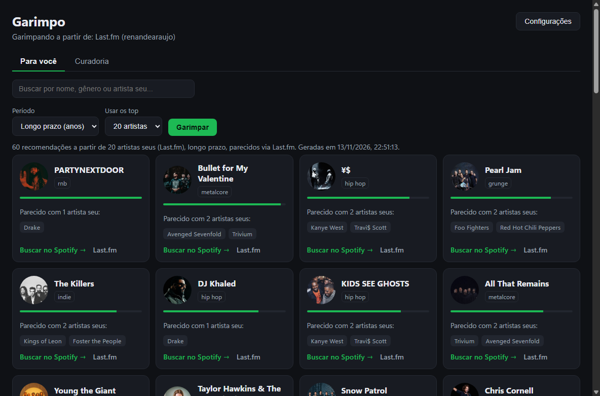

# Garimpo

[](https://github.com/Lobbyboya/garimpo/actions/workflows/testes.yml)

App de desktop (Electron) que garimpa artistas novos a partir do que você já ouve.
Cada pessoa usa as próprias contas; nada sai do seu computador além das consultas às APIs.



## De onde vem o seu gosto musical

Use pelo menos uma das três fontes, em **Configurações**:

- **Spotify**: você entra com a sua conta e o app lê os seus top artistas (permissão `user-top-read`).
- **Last.fm** (opcional): só o nome de usuário, quando o app vem com a chave de API embutida
  (veja abaixo). Sem ela, o guia passo a passo ajuda a criar uma chave própria.
- **Lista manual** (opcional): digite alguns artistas de que você gosta. É o que a tela de
  boas-vindas pede na primeira vez, e já funciona sem conta nenhuma.

### Chave do Last.fm embutida (para quem distribui o app)

Crie uma chave em https://www.last.fm/api/account/create com a sua conta (nome "Garimpo",
callbacks vazios) e cole a **API key** em `LASTFM_CHAVE_PADRAO`, em `src/dados/config.js`. A chave
é da aplicação e o app só lê dados públicos, então ela pode ir no instalador; o *Shared secret*
não é usado e não deve ser colado. Para testar sem editar o código:
`GARIMPO_LASTFM_CHAVE=... npm start`.

Os artistas parecidos vêm do Last.fm quando há chave configurada. Sem chave, vêm dos
"artistas relacionados" do Deezer, que é público e não precisa de conta. As fotos vêm do Deezer.

### Regras do Spotify que você precisa conhecer

O login do Spotify exige um **Client ID**, registrado no painel de desenvolvedor do Spotify.
Desde 2026 o Spotify impõe, para apps em modo de desenvolvimento:

- quem registra o Client ID precisa ter **Spotify Premium**;
- cada Client ID aceita até **5 contas**, cadastradas em "User Management" no painel.

Por isso o app não traz um Client ID embutido: cada pessoa cria o seu (o guia dentro do app
explica), ou usa o de um amigo que a tenha adicionado. Quem não tem Premium ainda pode usar o
app com o Last.fm ou com a lista manual. O endereço de retorno a registrar é
`http://127.0.0.1:48721/callback`.

## Como rodar

Precisa do Node.js. Na primeira vez:

```bash
npm install
```

Para abrir o app:

```bash
npm start
```

## Testes

```bash
npm test
```

Os testes usam um Electron e um `fetch` falsos (em `test/ajuda/`), então não abrem o app nem
acessam a internet. Eles rodam no GitHub a cada envio e antes de cada release.

## Instalador e ícone

- `npm run instalador`: gera `dist/Garimpo Setup 1.0.0.exe`, que instala o app e cria atalhos na
  Área de Trabalho e no menu Iniciar. O instalador não é assinado, então o Windows pode mostrar
  um aviso do SmartScreen.
- `npm run icone`: regenera `build/icon.png` e `build/icon.ico` a partir de `build/icon.svg`.
- `build/identidade-visual.html`: ícone, cores e tipografia do app.

## Como a recomendação é calculada

1. Cada artista que você ouve vira uma "semente" com peso de 0 a 1: no Last.fm, scrobbles ÷
   scrobbles do seu artista mais ouvido; no Spotify, a posição no ranking (ele não informa
   contagens); na lista manual, 0,8.
2. O app busca os parecidos das N sementes mais fortes.
3. Cada parecido soma `similaridade × peso da semente`. Quem você já ouve fica de fora.

## Curadoria dinâmica

A aba "Curadoria" organiza as recomendações pelos seus grupos de gosto. Nada é fixo:

- Os grupos saem dos gêneros dos artistas que você mais ouve (gêneros do Spotify; quando faltam,
  tags do Last.fm). O app pega o gênero que mais pesa entre os seus artistas, junta quem o tem e
  repete, até 5 grupos. O resto vai para "Outros".
- Cada recomendação entra no grupo do artista seu que mais a puxou e mostra o próprio gênero.
- Com o Spotify conectado, o link abre direto a página do artista. Sem ele, abre a busca.
- Ao abrir o app, se o último resultado tem mais de um dia, tudo é refeito sozinho. Assim os
  grupos e as recomendações acompanham o que você anda ouvindo.

## Aparência

Em Configurações > Aparência: modo **Sistema**, **Claro** ou **Escuro**, e um tema de cores:
Garimpo, Tokyo Night, Dracula, Catppuccin, Nord, Gruvbox, Solarized, Rosé Pine e One Dark/Light.
Cada tema tem a versão clara e a escura oficiais, e todas passam no contraste mínimo de leitura
(WCAG AA). A escolha fica salva na configuração e vale também depois de atualizar o app.

Para adicionar ou ajustar um tema, edite as paletas em `scripts/gerar-temas.py`, rode
`python3 scripts/gerar-temas.py` (gera `src/renderer/temas.css`) e inclua o nome em
`src/renderer/js/aparencia.js`.

## Ouvir e navegar

- **Prévias**: cada cartão tem as 3 músicas mais tocadas do artista, com 30 segundos de áudio.
- **Ouvir em sequência**: na aba "Para você", toca uma prévia de cada artista da lista, um depois do
  outro, destacando o cartão. Respeita o filtro e a busca.
- **Filtros**: "Novos" (nunca recomendados antes) e "Pouco conhecidos" (menos de 50 mil fãs no Deezer).
- **Não curti**: o "×" do cartão tira o artista das recomendações de vez (dá para desfazer ou
  restaurar em Configurações).
- Quando o Garimpar termina com o app em segundo plano, chega uma notificação do sistema.

Atalhos: `/` busca · `1` `2` `3` trocam de aba · `Espaço` pausa ou continua a prévia · `N` próximo
artista na sequência · `Esc` limpa a busca.

## Salvos

Toque no marcador de um cartão para guardar o artista na aba **Salvos**. As recomendações mudam
conforme o que você ouve; os salvos não. Cada um mostra quando foi salvo, de qual artista seu
veio e se ainda aparece nas recomendações, e pode ser marcado como "Já ouvi".

## Estatísticas de uso (opcionais)

Na primeira abertura o app pergunta se a pessoa quer enviar estatísticas anônimas; a escolha pode
ser trocada em Configurações, onde também há "Apagar o que já foi enviado". Vai só o tipo de uso
(abrir o app, garimpar, salvar, prévias, abas), fontes ligadas, versão, sistema e um código
aleatório da instalação. Nunca nomes, e-mails, contas, chaves ou nomes de artistas.

Para receber as estatísticas (administrador):

1. Crie um projeto no [Supabase](https://supabase.com) e rode `supabase/telemetria.sql` no SQL Editor.
2. Em Project Settings > API, copie a URL do projeto e a chave **publishable** (ou a "anon").
   Nunca use a `secret`/`service_role`.
3. Cole as duas em `URL_PROJETO` e `CHAVE`, no topo de `src/servicos/supabase.js`, e gere uma
   nova versão. Sem elas a opção nem aparece no app.
4. Veja os números no SQL Editor, por exemplo `select * from estatisticas.ativos_por_dia;`. Também
   há `ativos_por_semana`, `recursos_30_dias`, `fontes_e_motor`, `versoes` e `retencao`.

Para testar sem gerar versão: `GARIMPO_SUPABASE_URL=... GARIMPO_SUPABASE_CHAVE=... npm start`.

## Onde ficam os seus dados

Em `%APPDATA%\garimpo\` no Windows ou `~/.config/garimpo/` no Linux: `config.json` (usuário e
chave do Last.fm, Client ID e login do Spotify, lista manual), `cache.json` (último resultado) e
`salvos.json` (artistas salvos) e `telemetria.json` (sua escolha sobre estatísticas e a fila de envio).
A configuração é gravada de forma segura (nunca fica pela metade) e a versão anterior fica em
`config.json.bak`: se o arquivo se corromper, o app usa a cópia e guarda o corrompido à parte. Os tokens do Spotify são guardados cifrados pelo sistema.
Nada disso fica na pasta do projeto.

## Estrutura

O código é separado em camadas. Cada uma só usa as que vêm depois dela na lista:

```
src/
├── main/            processo principal do Electron (único que fala com a interface)
│   ├── index.js         ciclo de vida do app (ponto de entrada)
│   ├── ipc.js           canais com a interface; só traduz chamadas para os módulos abaixo
│   ├── janela.js        a janela
│   ├── links.js         links externos (só https e sites conhecidos)
│   ├── contas.js        login do Spotify e chave do Last.fm
│   ├── recomendacoes.js Garimpar: fontes da config, cache e estatística do uso
│   ├── previas.js       prévias de 30 s conferidas para a interface
│   ├── atualizacoes.js  versão nova no GitHub e qual instalador oferecer
│   └── telemetria.js    estatísticas de uso opcionais (fila local e envio)
├── recomendacao/    o algoritmo, sem Electron: recebe as fontes e devolve as recomendações
│   ├── index.js         junta as etapas
│   ├── sementes.js      1. o que a pessoa ouve vira sementes com peso
│   ├── similares.js     2. parecidos de cada semente e pontuação
│   ├── enriquecer.js    3. link do Spotify, gênero e foto
│   ├── agrupar.js       grupos de gosto da Curadoria
│   └── tags.js          limpeza de tags e gêneros
├── dados/           o que fica salvo no computador
│   ├── arquivos.js      pasta dos dados
│   ├── config.js        config.json
│   ├── salvos.js        salvos.json
│   └── segredos.js      tokens cifrados pelo sistema
├── servicos/        clientes das APIs externas (só HTTP, sem estado do app)
│   ├── spotify.js, spotify-login.js, lastfm.js, deezer.js, github.js, supabase.js
├── comum/           utilitários sem dependências: texto, rede, json, lotes, versao
├── preload.js       ponte segura entre a interface e o processo principal
└── renderer/        interface (HTML, CSS e módulos JS)
    └── js/              app.js liga tudo; um módulo por tela ou assunto
```

## Limitações conhecidas

- A busca de artistas e os gêneros do Spotify ainda não foram testados com uma conta real.
- Sem Spotify e sem chave do Last.fm não há gêneros, então a Curadoria fica sem grupos.
- "Longo prazo" no Last.fm é o histórico inteiro, inclusive o que você ouvia anos atrás.

## Licença

[MIT](LICENSE)
